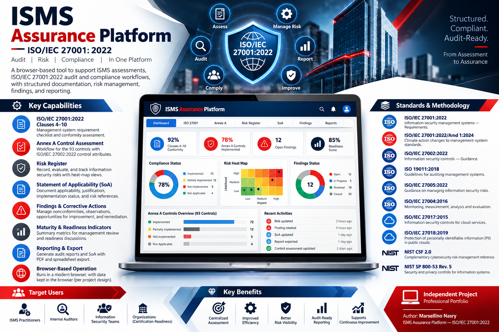

# ISMS Assurance Platform — ISO/IEC 27001:2022

<p align="center">
  
</p>

**Author:** Marsellino Nasry  
**Project type:** Browser-based ISMS audit, risk, and compliance support tool  
**Status:** Independent project / professional portfolio

## Overview

The **ISMS Assurance Platform** is a browser-based tool designed to support information security management system (ISMS) assessments and ISO/IEC 27001:2022 audit and compliance workflows. It brings key assessment activities into one interface and supports structured documentation of control status, risk treatment, audit observations, and reporting.

The platform is intended for ISMS practitioners, internal auditors, information security teams, and organizations preparing for internal review or certification-readiness assessment.

## Main capabilities

Based on the current project implementation, the platform includes:

- **ISO/IEC 27001:2022 Clauses 4–10** — management-system requirement checklist and conformity assessment.
- **Annex A control assessment** — assessment workflow for the 93 controls in the ISO/IEC 27001:2022 Annex A set, with ISO/IEC 27002:2022 control attributes.
- **Risk register** — information-security risk recording, evaluation, residual-risk tracking, and risk heat-map views.
- **Statement of Applicability (SoA)** — documentation of control applicability, justification, implementation status, and related risk references.
- **Findings and corrective actions** — recording of nonconformities, observations, opportunities for improvement, and remediation actions.
- **Maturity and readiness indicators** — summary metrics to support management review and readiness discussions.
- **Reporting and export** — audit report and SoA outputs, with PDF and spreadsheet export capabilities.
- **Browser-based operation** — the HTML application is designed to run in a modern browser; project metadata states that working data remains in the browser.

> Feature descriptions should be checked against the version committed to this repository. Do not describe a feature as secure, validated, or production-ready without testing it.

## Standards and methodology references

The platform is designed to support work aligned with the following references. Use the current, licensed/authorized editions applicable to your organization.

1. **ISO/IEC 27001:2022** — Information security management systems — Requirements. Primary requirements standard for establishing, implementing, maintaining, and continually improving an ISMS.
2. **ISO/IEC 27001:2022/Amd 1:2024** — Climate action changes to management-system standards. Consider applicability when evaluating organizational context and interested-party requirements.
3. **ISO/IEC 27002:2022** — Information security controls — Guidance. Provides implementation guidance and control attributes associated with the Annex A control set.
4. **ISO 19011:2018** — Guidelines for auditing management systems. Useful guidance for audit principles, audit-programme management, and conducting management-system audits.
5. **ISO/IEC 27005:2022** — Guidance on managing information security risks. Useful reference for risk identification, analysis, evaluation, and treatment.
6. **ISO/IEC 27004:2016** — Information security management — Monitoring, measurement, analysis and evaluation. Useful for defining and evaluating ISMS performance measures.
7. **ISO/IEC 27017:2015** — Information security controls for cloud services. Relevant where cloud-service security is in scope.
8. **ISO/IEC 27018:2019** — Protection of personally identifiable information (PII) in public clouds acting as PII processors. Relevant where applicable to the processing context.
9. **NIST Cybersecurity Framework (CSF) 2.0** — Complementary cybersecurity risk-management reference; not a substitute for ISO/IEC 27001 requirements.
10. **NIST SP 800-53 Rev. 5** — Security and privacy controls for information systems and organizations; a supplementary control reference where appropriate.

### Official reference links

- ISO/IEC 27001:2022: https://www.iso.org/standard/82875.html
- ISO/IEC 27002:2022: https://www.iso.org/standard/75652.html
- ISO 19011:2018: https://www.iso.org/standard/70017.html
- ISO/IEC 27005:2022: https://www.iso.org/standard/80585.html
- ISO/IEC 27004:2016: https://www.iso.org/standard/64120.html
- ISO/IEC 27017:2015: https://www.iso.org/standard/43757.html
- ISO/IEC 27018:2019: https://www.iso.org/standard/76559.html
- NIST CSF 2.0: https://www.nist.gov/cyberframework
- NIST SP 800-53 Rev. 5: https://csrc.nist.gov/pubs/sp/800/53/r5/upd1/final

**Copyright and licensing:** ISO standards are copyrighted publications. This project should reference standards and their clause/control identifiers without redistributing copyrighted standard text unless you have the required rights. Obtain official publications from ISO or an authorized national standards body.

## Suggested repository structure

```text
isms-assurance-platform/
├── README.md
├── LICENSE
├── docs/
│   ├── methodology-and-limitations.md
│   ├── sample-isms-audit-report.pdf
│   └── sample-statement-of-applicability.pdf
└── src/
    └── iso27001isms.html
```

Adjust the structure to match the files actually committed. If the project is a single HTML file, it is fine to keep `iso27001isms.html` in the repository root.

## Getting started

1. Clone or download this repository.
2. Open `iso27001isms.html` in a modern browser.
3. Review the scope, assessment criteria, risk scales, and status values before entering engagement data.
4. Use fictitious or sanitized data for demonstrations.
5. Export and independently review generated reports before using them as formal audit deliverables.

Some libraries and assets may be loaded from third-party CDNs, so an internet connection may be required. Review dependencies and pin or self-host them if offline operation or controlled supply-chain requirements apply.

## Assurance, validation, and appropriate use

This platform is a **support tool**, not an automated certification engine or a replacement for professional judgement. In particular:

- A calculated readiness score does not establish conformity or guarantee certification.
- Applicability decisions and exclusions for Annex A controls must be justified through the organization's risk-treatment process and documented in the SoA.
- Control status should be supported by objective evidence and assessed in the context of the defined ISMS scope.
- Risk acceptance, nonconformity classification, and corrective-action closure require accountable human review.
- Validate generated calculations, exported files, and report wording before relying on them.
- A readiness threshold or maturity score is a project-specific indicator unless formally defined by the organization; it is not an ISO-prescribed certification threshold.
- The sample audit report and SoA are illustrative examples. They must not be presented as evidence of a real organization's certification or compliance.

## Privacy and data handling

The application metadata describes browser-based data handling. Before using it with real organizational information, independently verify:

- where data is stored (for example, local storage, IndexedDB, or memory);
- whether data is transmitted to any remote service;
- what third-party scripts, fonts, charting, spreadsheet, and PDF libraries are loaded;
- whether exported reports contain confidential information;
- how browser data is backed up, cleared, and protected on shared devices.

Do not enter production secrets, credentials, or sensitive client information into a demo instance. Treat exported reports as confidential according to the organization's classification policy.

## Sample artifacts

The repository may include the following illustrative outputs:

- `Sample ISMS Audit Report.pdf` — example audit-report structure, including scope, methodology, conformity assessment, Annex A status, risks, findings, and remediation planning.
- `Sample SoA.pdf` — example Statement of Applicability structure, including applicability decisions, justification categories, implementation status, and risk references.

These samples use a fictional demonstration organization and should be labelled **DEMO / NOT A REAL AUDIT** wherever distributed.

## Disclaimer

This project is provided for professional learning and ISMS assessment support. It is not affiliated with, endorsed by, or certified by ISO or IEC. ISO/IEC 27001 certification can only be issued by a competent certification body following its formal audit process. Users remain responsible for validating assessments, interpreting applicable requirements, protecting data, and obtaining appropriate legal and standards guidance.

## Author

**Marsellino Nasry**  
ISMS Assurance Platform — ISO/IEC 27001:2022 audit and compliance support
